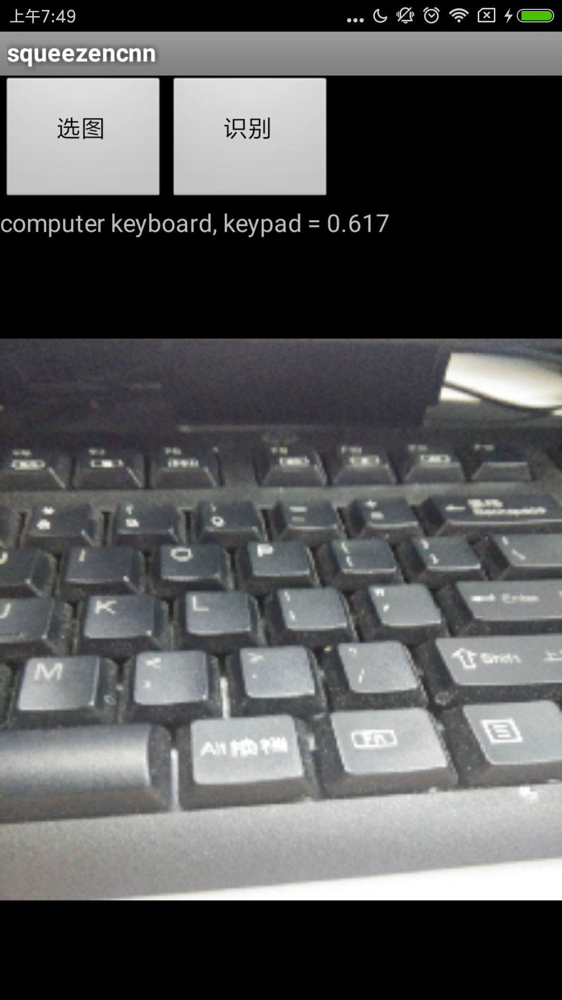
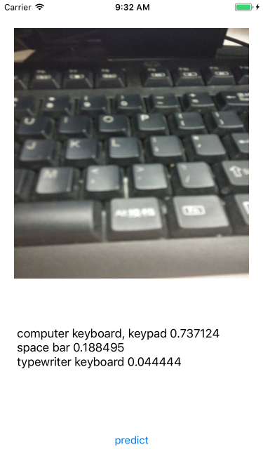

# ncnn-mobile
use [ncnn](https://github.com/Tencent/ncnn) in Android and iOS 

ncnn is a high-performance neural network inference computing framework optimized for mobile platforms. ncnn is deeply considerate about deployment and uses on mobile phones from the beginning of design. ncnn does not have third-party dependencies. It is cross-platform and runs faster than all known open-source frameworks on mobile phone cpu. Developers can easily deploy deep learning algorithm models to the mobile platform by using efficient ncnn implementation, creating intelligent APPs, and bringing artificial intelligence to your fingertips. ncnn is currently being used in many Tencent applications, such as QQ, Qzone, WeChat, Pitu, and so on.

Reference  
http://blog.csdn.net/best_coder/article/details/76201275  
https://github.com/Tencent/ncnn/issues/24

